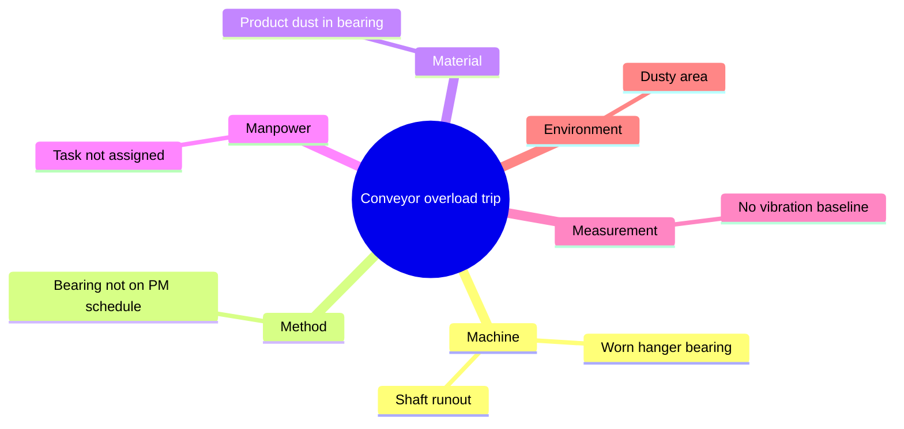

# Root Cause Analysis (RCA) Template

Use this after a breakdown or a repeat failure. Copy the file, fill in each section, and keep the finished report with the equipment records.

---

## 1. Incident summary

| Field | Details |
|---|---|
| Equipment / Asset ID | |
| Location | |
| Date and time of failure | |
| Reported by | |
| Downtime (hours) | |
| Safety, quality or product impact | |
| Analysis led by | |
| Others involved | |

## 2. Problem statement

*One or two factual sentences: what failed, when, and what the effect was. No causes or blame here.*

> 

## 3. Timeline

| Time | Event |
|---|---|
| | |
| | |

## 4. Containment (what was done to restore safe operation)

- [ ] Equipment isolated and made safe (LOTO applied)
- [ ] Temporary repair or workaround recorded
- [ ] Affected product checked or quarantined where relevant

## 5. 5 Whys

Keep asking "why" until you reach a cause you can fix. Stop when the answer points to a process, system or missing control, not just a worn part.

| Step | Question | Answer |
|---|---|---|
| Why 1 | Why did the failure happen? | |
| Why 2 | Why did that happen? | |
| Why 3 | Why did that happen? | |
| Why 4 | Why did that happen? | |
| Why 5 | Why did that happen? | |

**Root cause:** 

## 6. Fishbone (Ishikawa) check - the 6 Ms

Use this to make sure no cause category was missed.

| Category | Possible causes |
|---|---|
| **Machine** (equipment condition, wear, design) | |
| **Method** (procedures, PM tasks, work instructions) | |
| **Material** (parts, lubricants, product) | |
| **Manpower** (skills, training, workload) | |
| **Measurement** (data, gauges, condition monitoring) | |
| **Environment** (dust, heat, moisture, layout) | |

## 7. Corrective and preventive actions

| Action | Type (Corrective / Preventive) | Owner | Due date | Status |
|---|---|---|---|---|
| | | | | |

## 8. Verification

- [ ] Repair tested and equipment returned to service
- [ ] Preventive action added to the PM schedule
- [ ] FMEA updated if a new failure mode was found
- [ ] Re-check scheduled to confirm the failure has not returned (date: ______)

## 9. Lessons learned

*What should other technicians and shifts know?*

---

# Worked example (illustrative)

This example is for reference only. It is not a record of a real event.

**Problem statement:** The screw conveyor on line 1 tripped on overload and product spilled at the trough, causing a stoppage.

| Step | Question | Answer |
|---|---|---|
| Why 1 | Why did the conveyor trip? | The shaft was rubbing on the trough and overloaded the drive. |
| Why 2 | Why was the shaft rubbing? | Shaft runout was beyond the allowable limit. |
| Why 3 | Why was runout excessive? | A worn hanger bearing let the shaft sag and bend. |
| Why 4 | Why was the bearing worn? | It ran dry and product dust got into it. |
| Why 5 | Why did it run dry? | Greasing for that bearing was not on the PM schedule. |

**Root cause:** The hanger bearing lubrication task was missing from the PM schedule.

**Actions:** Replace the bearing and straighten or replace the shaft (corrective). Add a monthly greasing and runout check to the PM schedule, and add a vibration reading to the monthly route (preventive).

